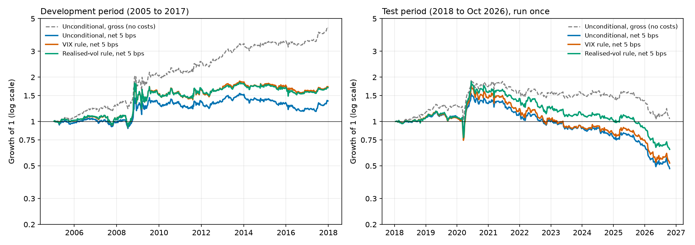

Buse Aydemir
23 October 2026

# Does Short-Term Equity Reversal Pay More After High VIX? A Sector-Adjusted Backtest on S&P 500 Stocks

**Summary.** I tested whether a weekly, sector-adjusted equity reversal strategy earns more after elevated VIX, and whether sizing positions on lagged VIX improves net performance. Out of sample (2018 to October 2026) the result is negative: the unconditional strategy loses 6.9% a year after 5 bps costs, the VIX rule loses 5.1% a year, and the improvement (+1.8% a year, t = 0.85) is not distinguishable from noise. A simpler rule that scales positions on realised volatility did at least as well as the VIX rule, so VIX added no information beyond volatility scaling. Full numbers are in the table at the start of Section 3.

## 1. Hypothesis Pitch

**The pattern.** Stocks that have fallen more than their sector peers over the last five trading days tend to rebound over the following week, and stocks that have risen more than their sector peers tend to give some of it back (short-term, sector-adjusted reversal).

**Why I think it exists.** My reasoning is about who sits on the other side of a price move. When a stock falls sharply for reasons unrelated to its sector, part of the move is usually price pressure: someone has to sell (a fund meeting redemptions, a risk limit being hit) and someone else has to be willing to buy. Liquidity providers will only absorb that selling if they expect to be paid for it, so the price overshoots and then recovers. The same logic works in reverse for stocks pushed up by buying pressure. Subtracting the sector average removes industry-wide news, so what is left is more likely to be stock-specific pressure than information. I expect the payment for providing liquidity to be larger when markets are stressed, because liquidity providers are more constrained and the pressure is larger, and the VIX is a convenient, publicly observable gauge of that stress. This liquidity-provision explanation of reversal and its link to the VIX is developed in Nagel (2012); what I do here is turn it into a rules-based test with costs, a sizing rule fixed in advance, a volatility benchmark and an untouched test period.

**Hypotheses.**
- **H1 (mechanism):** the gross return of the reversal strategy is higher in weeks that follow elevated VIX.
- **H2 (allocation):** a predefined, capped position-size rule based on lagged VIX improves out-of-sample, after-cost, risk-adjusted performance relative to the same strategy sized unconditionally.

**Why this is worth testing.** Two questions matter more to me than whether the pattern exists. First, does it survive realistic trading costs? Reversal strategies trade a lot, so the answer is not obvious. Second, does knowing the VIX level actually help size the bet? The VIX is entangled with volatility itself, so a rule based on it has to be compared with a plain volatility-scaling rule before the VIX is given any credit; that is why I added the realised-volatility benchmark. A negative answer to either question is still informative.

**What would prove me wrong.** I wrote the failure criterion down before running any analysis (`design_choices.md`): the hypothesis fails if (a) gross reversal returns are not higher after high VIX, or (b) the VIX rule does not beat the unconditional strategy after costs in the untouched test period. I also committed to reporting the result either way.

**Design, fixed in advance.** Universe: current S&P 500 members (survivorship bias acknowledged in Section 5). Signal: 5-day return minus the same-date mean 5-day return of the stock's GICS sector. Rebalance weekly; signal observed at the close of the last trading day of the week and traded at the close of the next trading day. Long the bottom decile, short the top decile, equal weight, dollar-neutral. Costs: 5 bps per side (10 bps stress test). Development period 2005 to 2017; test period 2018 to October 2026, run once. VIX rule: position multiplier = 0.5 + (expanding-window percentile of VIX on the signal date), so it lies between 0.5 and 1.5.

## 2. Data Pipeline

**Sources.** Daily split- and dividend-adjusted closing prices and the VIX index from Yahoo Finance (via `yfinance`), 2 January 2004 to 21 October 2026. The list of current S&P 500 constituents and their GICS sectors was scraped from Wikipedia. No API keys are needed.

**Snapshot.** `data_pipeline.py` builds the snapshot in `data/`: `prices.csv.gz` (5,736 trading days by 499 tickers), `sectors.csv`, `vix.csv`, `dropped_tickers.csv` (each dropped ticker with a reason) and `pipeline_log.txt`. The notebook only calls `load_snapshot()`, so it runs offline and reproducibly. Running `python data_pipeline.py --refresh` rebuilds the snapshot.

**Engineering decisions.**
- My first version downloaded in parallel and Yahoo timed out silently, returning empty columns that were then dropped without explanation. The pipeline now downloads sequentially in batches of 25 with a 30-second timeout, retries every ticker that comes back empty, and records the reason for every ticker it drops. The final run had 0 download failures.
- Four tickers were dropped for having more than 95% missing days (FDXF, HONA, Q, VYLR). Late IPOs are kept, with missing values before listing; the strategy only trades a stock that has a price on the trade date. I deliberately did not require a long price history, because doing so would filter the universe using information not available at the time.
- Prices are never forward-filled. Returns use `pct_change(fill_method=None)` so gaps do not create artificial returns. VIX is forward-filled only (to cover days when the VIX series and the stock calendar differ), which cannot leak future values.
- I inspected the largest daily moves across the whole sample (including two in the test period, PCG in 2019 and MRNA in 2026), and made no change to the strategy as a result.

**Known limitations.** The universe and sector labels are today's, not point-in-time (Section 5). If a stock is tradable on one trade date but has no price on the next, its return for that week is counted as zero in the backtest; this is rare in a universe of current constituents but not impossible.

## 3. Strategy and Backtest

### Key results

Weekly returns; annualised with 52 periods; Sharpe ratio = annualised mean return / annualised volatility (no risk-free rate, because the portfolio is dollar-neutral). "Net" is after costs per side of 5 bps unless stated.

**In-sample (development period, 2005 to 2017, 676 weeks)**

| Strategy | Cumulative return | Annual return | Annual vol | Sharpe | Max drawdown |
|---|---|---|---|---|---|
| Unconditional, gross (no costs) | +333.7% | 12.4% | 15.2% | 0.82 | -20.5% |
| Unconditional, net 5 bps | +38.0% | 3.6% | 15.2% | 0.24 | -24.4% |
| VIX rule, net 5 bps | +72.1% | 6.2% | 20.5% | 0.30 | -32.9% |
| Realised-vol rule, net 5 bps | +69.8% | 6.1% | 20.3% | 0.30 | -32.8% |
| Unconditional, net 10 bps | -56.2% | -5.2% | 15.2% | -0.34 | -62.0% |
| VIX rule, net 10 bps | -44.3% | -2.5% | 20.5% | -0.12 | -58.8% |
| Realised-vol rule, net 10 bps | -45.0% | -2.6% | 20.3% | -0.13 | -59.1% |

**Out-of-sample (test period, January 2018 to October 2026, 458 weeks, run once)**

| Strategy | Cumulative return | Annual return | Annual vol | Sharpe | Max drawdown |
|---|---|---|---|---|---|
| Unconditional, gross (no costs) | +4.2% | 2.0% | 17.3% | 0.11 | -46.1% |
| Unconditional, net 5 bps | -52.1% | -6.9% | 17.3% | -0.40 | -69.0% |
| VIX rule, net 5 bps | -47.8% | -5.1% | 21.7% | -0.23 | -70.4% |
| Realised-vol rule, net 5 bps | -35.3% | -2.9% | 20.5% | -0.14 | -65.4% |
| Unconditional, net 10 bps | -78.0% | -15.7% | 17.3% | -0.91 | -82.4% |
| VIX rule, net 10 bps | -77.4% | -14.5% | 21.7% | -0.67 | -84.1% |
| Realised-vol rule, net 10 bps | -70.6% | -11.8% | 20.5% | -0.58 | -80.6% |

**Mechanism test (H1): weekly gross return by VIX tercile**

| | Low VIX | Mid VIX | High VIX | Slope on VIX percentile |
|---|---|---|---|---|
| Development: mean weekly gross return | 0.12% | 0.08% | 0.52% | +0.0053 (p = 0.10) |
| Development: weekly volatility | 1.0% | 1.2% | 3.3% | |
| Test: mean weekly gross return | 0.26% | -0.33% | 0.31% | +0.0078 (t = 1.25, p of about 0.21) |

Slopes come from an OLS regression of weekly gross return on the lagged VIX percentile with Newey-West (HAC, 4 lags) standard errors. Terciles use fixed cutoffs at percentiles 1/3 and 2/3.

**Allocation test (H2): VIX rule minus unconditional, net 5 bps.** Development: +0.05% a week (+2.6% a year), t = 1.57. Test: +0.035% a week (+1.8% a year), t = 0.85. The average position multiplier was 0.98 in development and 1.07 in the test period.

**Figure 1. Growth of 1 invested (log scale): development period (left) and test period (right).** Dashed grey: unconditional strategy before costs. Solid lines: net of 5 bps per side.

### What was built

1. **Signal.** For each stock and date, the 5-day return minus the mean 5-day return of its GICS sector on that date.
2. **Portfolio.** At the close of the last trading day of each week, rank all stocks that have a signal and a price on the next trading day. Long the bottom 10% (about 42 names per side in the development period) and short the top 10%, each leg equal-weighted and summing to 100% of capital, so the portfolio is dollar-neutral (asserted in the code).
3. **Timing.** Trade at the close of the next trading day (asserted to be strictly after the signal date) and hold until the next week's trade date.
4. **Costs.** Cost per week = turnover x bps / 10,000, where turnover is the sum of absolute weight changes (at most 4 when both legs are fully replaced). Average weekly turnover was about 3.4 in the development period, which at 5 bps is a drag of about 8.8% a year. This matches the gap between gross (12.4%) and net (3.6%) annual return.
5. **VIX rule.** Each week the positions are multiplied by 0.5 + p, where p is the percentile of VIX on the signal date within all VIX values observed up to that date (expanding window, at least 250 days). Until 250 days of history exist the multiplier is 1.0. Costs are charged on the scaled positions.
6. **Benchmark.** The same rule driven by the percentile of the 21-day realised volatility of the equal-weighted average stock return, to test whether VIX adds anything beyond volatility scaling.

### Results discussion

- **There was a gross reversal effect in development, and it nearly vanished out of sample.** Gross Sharpe fell from 0.82 (2005 to 2017) to 0.11 (2018 to 2026).
- **After costs, the return came almost entirely from crisis episodes (Figure 1; values are approximate, read from the chart).** In development the net curves are roughly flat except for a jump in late 2008 and early 2009 (about 0.9 to 1.4 for the unconditional strategy) and are roughly flat again afterwards, while the gross curve rises more steadily to about 4.3. In the test period all versions fall by roughly 30% within a few weeks in March 2020, recover sharply to a peak in mid-2020 (net about 1.5, gross about 1.8), and then decline for the rest of the period; gross ends near 1.05 and net near 0.5. In both periods the strategy earned its money in high-VIX episodes (2008 to 2009 and 2020), which is the direction H1 predicts, but these are two episodes, so the effective sample is much smaller than 676 and 458 weeks, and outside them net returns are flat or negative. The VIX-rule and realised-vol-rule curves almost coincide in development.
- **Costs dominate.** The strategy trades most of its book every week. After 5 bps the development Sharpe falls to 0.24 and the test Sharpe is -0.40; at 10 bps the strategy loses money in both periods.
- **H1 is weakly and inconsistently supported.** The slope on VIX is positive in both periods but not significant in either. In development, mean returns in the high-VIX tercile are four times those in the low tercile, but volatility is 3.3 times higher, so return per unit of risk (roughly 0.9, 0.5 and 1.1 across terciles) is only slightly better. In the test period the pattern is not monotonic (mid-VIX is negative).
- **H2 is not supported.** The VIX rule has a better point estimate than the unconditional strategy in both periods, but neither gain is statistically significant, the rule still loses money out of sample, and its drawdown is slightly deeper. The realised-vol rule beat the VIX rule out of sample (Sharpe -0.14 against -0.23), so the improvement comes from volatility scaling and not from information specific to VIX.
- **Verdict against my own failure criterion:** not supported. The evidence does not show that reversal returns are reliably higher after high VIX, and the sizing rule does not deliver a reliable after-cost improvement.

## 4. Methodology Defense

- **Universe: current S&P 500 members.**
  *Why:* large, liquid stocks where shorting is feasible and trading costs of 5 to 10 bps are plausible; free data is available. *What breaks if wrong:* it is not point-in-time, so delisted, bankrupt and acquired firms are missing. This probably inflates reversal profits (Section 5), most of all in the 2008 to 2009 crisis.
- **Signal: 5-day return minus sector mean.**
  *Why:* a week is the horizon at which liquidity-driven reversal is documented; subtracting the sector mean removes industry news so the signal reflects stock-specific price pressure. *What breaks if wrong:* sector labels are today's, so some stocks are mis-grouped in earlier years; if the effect were really an industry effect, sector adjustment would remove it.
- **Weekly rebalance, deciles, equal weights, dollar-neutral.**
  *Why:* weekly trading limits turnover compared with daily; deciles keep about 42 names per side for diversification while keeping a strong signal; dollar-neutrality removes most market exposure so the VIX question is about the reversal premium and not market direction. *What breaks if wrong:* equal weights ignore liquidity differences, and dollar-neutral is not beta-neutral.
- **Trade one day after the signal, at the close.**
  *Why:* the signal uses the close of day t, so it cannot be traded at that same close. *What breaks if wrong:* if the day-t close could be traded the backtest would be look-ahead; trading at a close ignores slippage and market impact.
- **Transaction costs: 5 bps per side, 10 bps stress.**
  *Why:* a plausible all-in cost for large caps; the stress case shows sensitivity. *What breaks if wrong:* costs are not constant; spreads widen when VIX is high, so a flat assumption flatters the VIX rule. Borrow costs for shorts and market impact are not modelled.
- **Train/test split: 2005 to 2017 for development, 2018 to October 2026 for the test.**
  *Why:* development includes the 2008 crisis and a range of VIX levels; the test is a long, entirely later period (8.8 years, including the 2020 crash and the 2022 rate shock), so it is a real test of whether a rule fixed in advance keeps working. *What breaks if wrong:* one split only, so the result depends on this particular test period; the test period was run once to avoid tuning.
- **VIX rule: expanding-window percentile, multiplier clipped to 0.5 to 1.5.**
  *Why:* a percentile avoids hand-picking a VIX threshold and uses only past data; the clip limits leverage to a stated range; a single continuous rule has no free tuning parameter. *What breaks if wrong:* it assumes the VIX distribution is comparable over time; and because VIX conflates volatility and liquidity, the rule might just be scaling positions on volatility, which is why I added the realised-vol benchmark.
- **Inference: Newey-West (HAC) standard errors, 4 lags.**
  *Why:* weekly returns can be autocorrelated and high-VIX weeks cluster in a few episodes. *What breaks if wrong:* even HAC errors may be too optimistic when the effective sample is a handful of crisis episodes.

## 5. Pitfall Checklist

### Look-ahead bias

*What I checked, and how it appears in the code:*
- The signal uses only returns up to the close of day t. The trade date is the next trading day, and the code asserts `trade_dates > reb_dates`.
- VIX is read on the signal date (close of day t), before the trade. The VIX percentile uses an expanding window, so it only uses values up to that date. VIX is forward-filled only.
- Sector means are computed cross-sectionally on the same date, using only that date's returns.
- Development runs pass `end=DEV_END`, so no price after 31 December 2017 can enter a development result.

*What I could not fully remove:* the universe is today's constituents and the sector labels are today's, which is a form of look-ahead in universe construction (see Survivorship bias). Dropping four tickers for more than 95% missing days used full-sample missingness; it affects only four tickers and I deliberately set the threshold to avoid filtering on history length. My outlier check looked at the full sample, including test-period dates, but I made no strategy change from it.

### Survivorship bias

The universe is the 499 usable current S&P 500 members. Companies that were delisted, went bankrupt or were acquired between 2004 and 2026 are not in the data. Because the strategy buys recent losers, the losers that kept falling to zero are missing from the long leg, so reversal profits are probably overstated, especially in 2008 to 2009 when many failures occurred. Crises also coincide with high VIX, so the bias could inflate the apparent VIX effect in H1. I did not correct for it, because free data does not give point-in-time constituents, and I did not quantify the size of the bias. Two consequences: the development gross Sharpe of 0.82 is probably an overestimate, and the out-of-sample result is already negative, so the bias cannot be what makes the strategy fail.

### Overfitting/data-snooping

I fixed the design (`design_choices.md`, commit 042ce5c) before running any backtest: one signal horizon (5 days), one decile, one weekly frequency, one cost level plus one stress level, one VIX rule with no free parameters beyond its stated 0.5 to 1.5 range. I tried exactly one configuration of each and did not tune anything. All parameters were chosen in advance from economic reasoning and standard conventions, not by searching.

*Development-period analyses run:* the baseline backtest (gross, 5 bps, 10 bps), one regression and one tercile table, the VIX rule (5 and 10 bps), and the realised-vol benchmark (5 and 10 bps). *Test period:* run once.

*Disclosures:* the realised-vol benchmark (21-day window) was added during development, before the test, to address the volatility confound; it was not in the original design file. The printout of gross test-period returns was added after I had seen the test-period net results, and is descriptive only. I ran about four hypothesis-style comparisons on the test set (H1 regression, H2 gain, and the two benchmarks) and applied no multiple-testing correction; none is significant at 5%, so a correction would not change the conclusion. The equity-curve figure (Section 3) and the sector-exposure diagnostic (Section 7) were also added after I had seen the test results. The figure plots results already reported, and the sector diagnostic uses only development-period positions and no returns; neither changed any rule or any reported number.

### Transaction costs and slippage

I charge 5 bps per side on all traded notional (sum of absolute weight changes), and stress this at 10 bps. Average weekly turnover of about 3.4 (maximum 4) makes costs the dominant effect: about 8.8% a year of drag at 5 bps. The strategy looks attractive before costs (development gross Sharpe 0.82) and unattractive after them (0.24 at 5 bps; negative at 10 bps; negative at 5 bps out of sample). *Not modelled:* borrow fees on shorts, market impact, intraday slippage between signal and close, and costs that vary with VIX. Spreads widen when VIX is high, so a flat cost assumption flatters the VIX rule, which trades more in exactly those conditions.

### Out-of-sample validation

The data were split in time: development 2005 to 2017, test January 2018 to October 2026. All design and exploration used only the development period; the test period was run once, after the rules were committed to git (commit ea8a997 for the frozen rules, d38d71c for the test results). Performance decayed out of sample: unconditional gross Sharpe 0.82 to 0.11; net 5 bps Sharpe 0.24 to -0.40; VIX-rule net Sharpe 0.30 to -0.23; the VIX slope remained positive but insignificant. I used a single split rather than walk-forward validation, so the conclusion rests on one test period and I cannot say how much of the decay is regime-specific.

## 6. Efficiency Touchpoint

The most computationally expensive step is the weekly backtest loop (`run_reversal`). For each of the W rebalance dates (676 in the development period) it ranks the N, about 500, stocks that have a signal and a price (`nsmallest` and `nlargest`), builds a weight vector, and computes that week's return and turnover. The work per week is O(N log N) for the ranking plus O(N) for everything else, so the total is **O(W · N log N)**: roughly 676 x 500 x 9, about 3 million basic operations per run. In practice one run takes about 1.2 seconds (measured), mostly pandas overhead from building and indexing a 499-element Series each week. That is acceptable at this scale: the notebook runs about fourteen backtests, around 16 seconds in total (from the cell timings). I could reduce it in two ways. First, the costs do not change which stocks are picked (cost = turnover x bps, applied afterwards), so one pass could produce both the 5 bps and 10 bps results and halve the number of runs. Second, the ranking could be vectorised across all weeks at once (`DataFrame.rank(axis=1)`), removing the Python loop; that would be necessary for thousands of stocks or daily rebalancing.

The expanding-window VIX percentile is the worst step asymptotically, **O(T²)**: each of T = 5,736 days recomputes its rank over all earlier values, about 16 million comparisons. It takes only 0.04 seconds here (measured) because the comparisons run in compiled array code, so it would only matter at much larger T, where an online order-statistic structure (O(T log T)) would be used. Downloading the data is the slowest step in wall-clock time (minutes) but is network-bound, runs once, and is cached in the `data/` snapshot.

## 7. Risk Touchpoint

- **Sizing and leverage.** Each leg is 100% of capital, so gross exposure is 200% and net exposure is zero. The VIX rule scales this by 0.5 to 1.5, so gross exposure ranges from 100% to 300% (average multiplier 1.07 in the test period, about 214% gross). Volatility rose from 17.3% to 21.7% a year under the VIX rule. Financing and margin costs are not modelled.
- **Concentration.** There are about 42 names per side in the development period, so each position is roughly 2.3% of its leg, which is well diversified by name. It is not diversified by risk source: all positions load on the same factor (short-term reversal), and the signal is sector-adjusted but the long and short counts per sector are not constrained. I measured net sector exposure in the development period (each leg is 100% of capital): the average net weight in any one sector is close to zero (between -0.5% and +0.5% of capital) and the average absolute net weight per sector is 1.8% to 4.3%, but the sector tilts add up to about 33% of one leg's capital in an average week, and in individual weeks one sector can carry a large net position (up to 34% of capital in Financials and 25% in Communication Services). The largest sector makes up about 23% of the long leg on average. The portfolio is therefore not sector-neutral by construction.
- **Bad scenario.** A volatility spike or deleveraging episode in which recent losers keep falling and recent winners keep rising, as in crowded quantitative unwinds, would hurt this strategy, because it is long losers and short winners. The VIX rule makes this worse, because it increases size (up to 1.5 times) when VIX is high, while spreads are wide and costs are higher than assumed. The measured drawdowns give a sense of scale: the unconditional strategy's gross maximum drawdown in the test period was -46.1%, and the VIX rule's net drawdown was slightly deeper than the unconditional (-70.4% against -69.0%). March 2020 is a concrete example of the scenario: all versions lost roughly 30% within a few weeks (Figure 1) before the sharp rebound, so a high-VIX regime is where this strategy can lose quickly as well as gain.

## 8. Reflection

**What I learned.** Backtest mechanics matter as much as the signal. The gross Sharpe of 0.82 shrank to 0.24 after 5 bps of costs, because weekly rebalancing of two deciles turns over most of the book. I also learned that a result which "improves" with a conditioning variable needs a fair benchmark: the VIX rule looked better than the unconditional strategy, but a rule using realised volatility did as well, so the gain was volatility scaling and not something specific to VIX. On the engineering side, the data source failed silently at first (timeouts that looked like missing stocks), and I learned to log the reason for every dropped asset and to stop the universe filter from using information that would not have been known at the time.

**What I got wrong.** I expected the liquidity-provision story to show up cleanly. In development, the VIX effect was suggestive (p = 0.10) but most of the extra return after high VIX came with 3.3 times higher volatility, and out of sample the pattern was not even monotonic. I also underestimated how much of the reversal premium would be left after costs, and how much survivorship bias could be flattering the development results. The equity curves also showed that after costs the return came almost entirely from two crisis episodes (late 2008 and March 2020), so what looked like a steady edge was closer to two events.

**Next steps.**
1. Use a point-in-time universe (historical index membership and historical sector labels) to quantify the survivorship bias directly.
2. Lower turnover, for example by rebalancing only when a signal crosses a threshold, using a longer holding period, or netting trades, and see whether any gross edge survives costs.
3. Use costs that depend on VIX or on observed spreads, include borrow costs, and neutralise market beta and sector exposure.
4. Evaluate with a walk-forward or block-bootstrap design that respects the clustering of high-VIX episodes, and test on other universes (mid caps, other countries), where reversal may be larger.
5. Moving toward production would also require execution assumptions (not closing prices), capacity estimates, and risk limits on leverage and drawdown.

## References

- Nagel, S. (2012). Evaporating Liquidity. *Review of Financial Studies*, 25(7), 2005 to 2039.
- Data: Yahoo Finance (via `yfinance`) for daily prices and the VIX index; Wikipedia, "List of S&P 500 companies" (accessed October 2026) for constituents and GICS sectors.
- Tools: Claude (Anthropic) assisted with brainstorming, code review and drafting. The design, results and interpretation are my own work, and the code and numbers were checked against each other.
